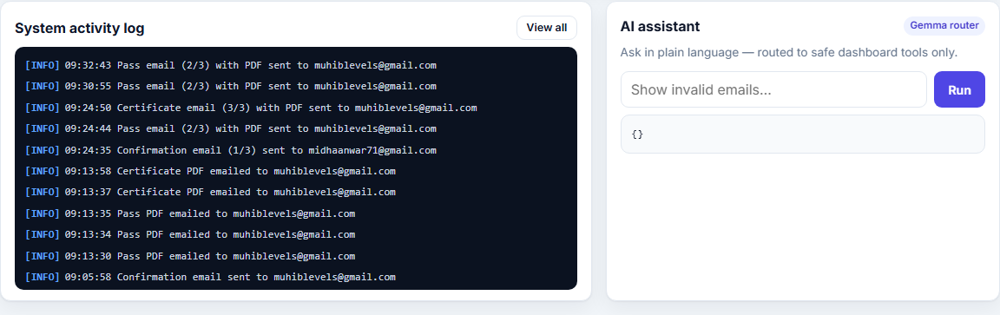
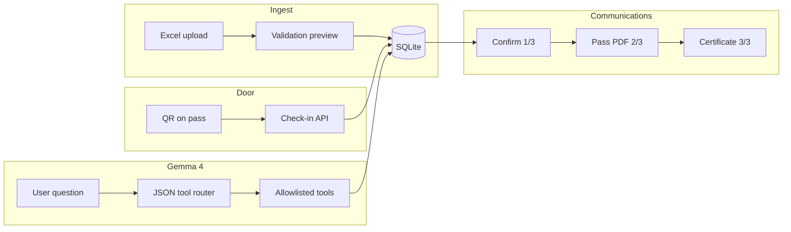
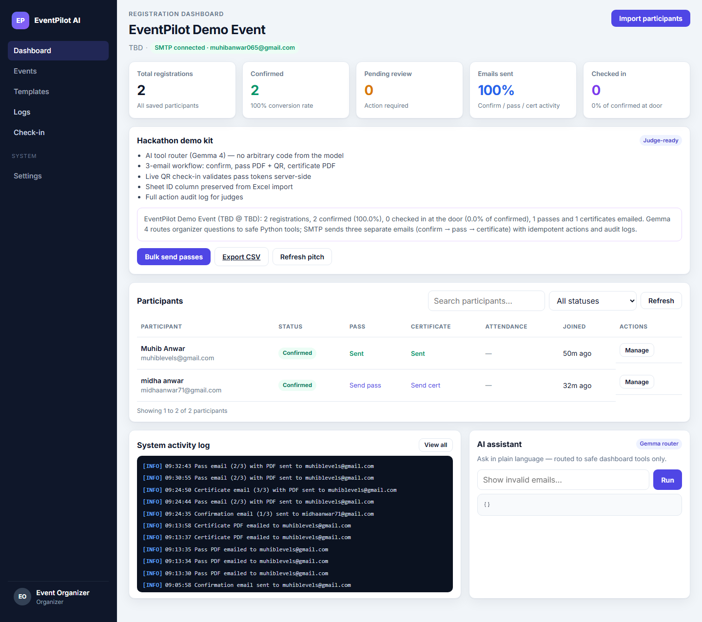

<div align="center">

# EventPilot AI

**Your event registration control plane — Excel in, validated dashboard out, Gemma-routed insights, and three branded emails with QR check-in.**

[](LICENSE)
[](https://www.python.org/)
[](https://fastapi.tiangolo.com/)
[](https://mlh.io/)

[](https://ai.google.dev/gemma)
[](https://ai.google.dev/gemma/docs/core/model_card)
[](https://ai.google.dev/gemma)

[Live repo](https://github.com/MuhibAnwar/eventpilot-ai) · [Product spec (PRD)](docs/PRD.md) · Check-in: `http://127.0.0.1:8000/check-in` when running locally

<br />


<p><em>Live dashboard: audit log stream + <strong>AI assistant</strong> (Gemma router chip, natural-language input, JSON tool output).</em></p>

</div>

---

## Inspiration

Hackathon weekends move fast: organizers get a messy `.xlsx`, invalid emails slip through, confirmations and passes go out in random order, and “just add ChatGPT” often means **API keys in the browser** or models that can do anything. We wanted one honest dashboard — import, fix, confirm, send — with **Gemma 4 as a safe tool router**, not an autonomous agent.

EventPilot AI is built for **Major League Hacking–style events**: small team, real SMTP demos, judges who care about **audit logs, idempotency, and AI guardrails**.

---

## What it does

| Area | What you get |
|------|----------------|
| **Import** | Upload `.xlsx` (`name`, `email`, optional sheet `id`) → validation preview → save |
| **Dashboard** | KPIs, search/filter, pending vs confirmed, pass/cert/check-in columns |
| **Email 1/3 — Confirm** | Human-approved modal → registration confirmed (HTML + plain, themed like the app) |
| **Email 2/3 — Pass** | PDF event pass with **QR token** (confirmed only) |
| **Email 3/3 — Certificate** | PDF certificate attachment (confirmed only) |
| **Check-in** | `/check-in` — camera QR (jsQR) or manual JSON → server validates token |
| **AI assistant** | Natural language → **Gemma 4** picks one allowlisted tool → Python runs the query |
| **Judge kit** | Activity log stream, `/api/dashboard/judge-summary`, CSV export, bulk send passes |



---

## Gemma 4 integration (hackathon track)

We use **`gemma-4-26b-a4b-it`** only in `app/agent.py` as a **structured tool router**:

1. User asks in plain English on the dashboard (“how many duplicates?”).
2. Gemma returns **JSON only**, e.g. `{"tool":"find_duplicates"}` (schema-enforced via `google-genai`).
3. The server validates against a fixed allowlist — no arbitrary code, no direct DB writes from the model.
4. Normal Python services answer with table-friendly results.

**Allowlisted tools:** `show_all`, `invalid_emails`, `find_duplicates`, `count_participants`, `none`

**Safety choices (for judges):**

- **AI proposes, humans approve** — Gemma never sends email or confirms registration; organizers click Confirm in the UI.
- **Secrets stay server-side** — `GEMINI_API_KEY` and SMTP credentials are loaded with `python-dotenv`; never sent to the browser.
- **Fail closed on AI** — API errors return `{"error":"AI unavailable"}`; the rest of the app keeps working.
- **Untrusted input** — spreadsheet cells and chat text are data; the UI escapes HTML when rendering.

Thinking level is set to **MINIMAL** and temperature **0** for stable routing during live demos.

<details>
<summary><strong>Full dashboard screenshot</strong></summary>



</details>

Regenerate screenshots after UI changes (app running on port 8000):

```powershell
pip install playwright
python -m playwright install chromium
python scripts/capture_readme_screenshot.py
```

---

## Tech stack

| Layer | Choice |
|-------|--------|
| API | **FastAPI** + **Uvicorn** |
| Data | **SQLite** (participants, action logs, idempotency keys) |
| Spreadsheets | **openpyxl** |
| AI | **Google GenAI SDK** → Gemma 4 26B |
| Email | **smtplib** + multipart HTML templates (`app/email_templates.py`) |
| PDFs / QR | **ReportLab**, **qrcode** |
| Frontend | Vanilla **HTML / CSS / JS** — no build step |
| Tests | **pytest** + **httpx** (17 tests; Gemma mocked) |

---

## Quick start

### Prerequisites

- Python 3.11+
- [Google AI Studio API key](https://aistudio.google.com/apikey) for Gemma routing
- (Optional) Gmail or other SMTP for live email demos — [Gmail App Password](https://support.google.com/accounts/answer/185833) if using Google

### Install & run

```powershell
git clone https://github.com/MuhibAnwar/eventpilot-ai.git
cd eventpilot-ai
python -m venv .venv
.venv\Scripts\activate
pip install -r requirements.txt
copy .env.example .env
```

Edit `.env` — minimum for AI:

```env
GEMINI_API_KEY=your_key_here
```

Optional SMTP + event branding (used in PDFs and emails):

```env
SMTP_HOST=smtp.gmail.com
SMTP_PORT=587
SMTP_USER=you@gmail.com
SMTP_PASSWORD=your-app-password
SMTP_FROM=you@gmail.com
SMTP_USE_TLS=true

EVENT_NAME=MLH Hackathon 2026
EVENT_DATE=2026-11-01
EVENT_VENUE=Main Hall
```

Optional lockdown for public demos:

```env
APP_PASSWORD=your-shared-password
```

Run:

```powershell
uvicorn app.main:app --reload
```

Open **http://127.0.0.1:8000/** — check-in volunteers use **http://127.0.0.1:8000/check-in**.

Sample workbook for judges: [`sample_participants.xlsx`](sample_participants.xlsx) (regenerate with `python scripts/generate_sample_xlsx.py`).

### Tests

```powershell
pytest
```

No live Gemma calls in CI — routing is mocked in tests.

---

## 5-minute judge demo script

1. **Import** — Upload `sample_participants.xlsx` → show red rows (bad email, duplicates) → save valid rows.
2. **Dashboard** — Filter pending → pick one row → **Confirm** → show email preview → send (SMTP) or explain dry path if SMTP off.
3. **Pass & cert** — **Send pass** → open PDF QR → **Send certificate** on another confirmed row.
4. **Check-in** — Open `/check-in` → scan QR from pass PDF → show success + timestamp on dashboard.
5. **Gemma** — Ask: *“Which emails are invalid?”* and *“How many participants?”* → show tool routing + results.
6. **Audit** — Scroll activity log → hit judge summary (`GET /api/dashboard/judge-summary`) or export CSV from UI/API.

---

## API overview

| Method | Path | Purpose |
|--------|------|---------|
| `POST` | `/api/upload/preview` | Validate Excel without saving |
| `POST` | `/api/participants/save` | Persist preview rows |
| `GET` | `/api/participants` | List + search/filter |
| `POST` | `/api/participants/{id}/confirm` | Idempotent confirm + email 1/3 |
| `POST` | `/api/participants/{id}/send-pass` | Email 2/3 + PDF |
| `POST` | `/api/participants/{id}/send-certificate` | Email 3/3 + PDF |
| `POST` | `/api/bulk/send-passes` | Batch passes for confirmed, unsent |
| `POST` | `/api/check-in` | Validate QR payload, mark attendance |
| `POST` | `/api/query` | Gemma tool router + execute tool |
| `GET` | `/api/dashboard/stats` | KPI numbers |
| `GET` | `/api/dashboard/judge-summary` | Narrative + metrics for pitches |
| `GET` | `/api/participants/export.csv` | CSV download |

Full requirements: [`docs/PRD.md`](docs/PRD.md).

---

## Challenges we hit

- **ReportLab + QR** — Drawing QR straight into PDF failed; we rasterize to PNG bytes first, then embed with `ImageReader`.
- **Lazy GenAI client** — Import-time client init broke tests without a key; client is created on first route call.
- **Idempotent confirms** — Double-clicks and retries must not duplicate emails or logs; dedicated idempotency tables per action.
- **Three-email story** — Split confirm / pass / cert so judges see a clear pipeline instead of one bloated message.

---

## Accomplishments

- End-to-end **registration → confirm → pass → certificate → check-in** in one repo, no frontend toolchain.
- **Website-matched HTML emails** (dark sidebar palette, EP mark, Inter-style typography) plus plain-text fallbacks.
- **Gemma 4 JSON router** with schema + allowlist — demo-friendly and easy to explain to non-ML judges.
- **17 automated tests** covering validation, confirm idempotency, check-in, passes, and templates.

---

## What's next

- Persistent hosting (managed DB instead of ephemeral SQLite on PaaS)
- Google Sheets sync for live collaborator edits
- Multi-event / multi-organizer tenancy
- Scheduled certificate sends and reminder campaigns

---

## Project structure

```
app/
  main.py           # FastAPI routes
  agent.py          # Gemma 4 tool router
  services.py       # Business logic + idempotency
  email_templates.py
  documents.py      # Pass + certificate PDFs
  hackathon.py      # Judge summary + CSV
static/             # Dashboard + check-in UI
tests/              # pytest suite
docs/PRD.md         # Full product requirements
```

---

## Deploy notes (DigitalOcean App Platform)

- **Run command:** `uvicorn app.main:app --host 0.0.0.0 --port 8080`
- Set encrypted env: `GEMINI_API_KEY`, SMTP vars, optional `APP_PASSWORD`
- SQLite on the container disk is **ephemeral** unless you attach storage or migrate to Postgres

---

## Team

**Muhib Anwar** — [@MuhibAnwar](https://github.com/MuhibAnwar)

Built for **MLH hackathon weekends** with **Gemma 4** as the intelligence layer behind a boring, reliable registration backend — the way production systems should use LLMs.

---

## License

MIT — see [LICENSE](LICENSE).
